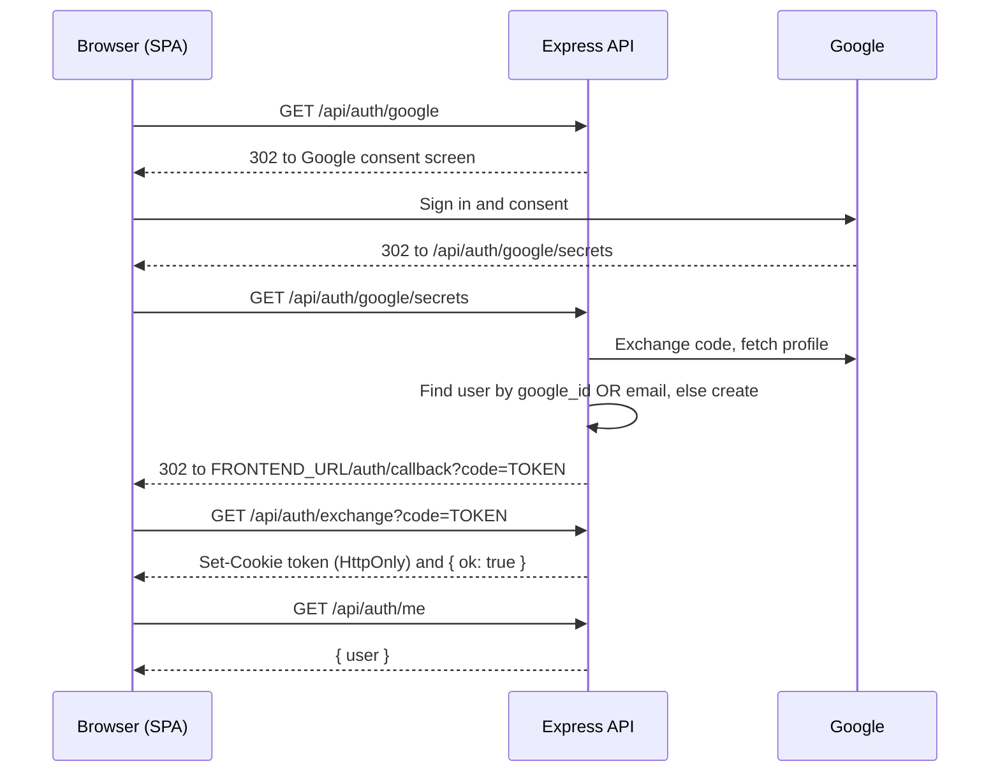

# Job Trackr — Backend

The REST API behind [Job Trackr](https://www.jobtrackrproject.work): authentication (Google OAuth + passwordless email OTP), job application tracking, and CV management with PDF storage.

Built with **Node.js, Express 4 and TypeScript** (ESM), backed by **PostgreSQL on Neon**, **Resend** for email and **Vercel Blob** for file storage.

---

## Table of contents

- [Tech stack](#tech-stack)
- [Project structure](#project-structure)
- [How a request flows through the app](#how-a-request-flows-through-the-app)
- [Authentication](#authentication)
- [API reference](#api-reference)
- [Business rules](#business-rules)
- [Running locally](#running-locally)
- [Deployment and CI](#deployment-and-ci)
- [Security notes](#security-notes)

---

## Tech stack

| Concern | Choice |
| --- | --- |
| Runtime / framework | Node.js, Express 4, TypeScript 5 (`NodeNext` modules) |
| Database | PostgreSQL (Neon) via `pg` connection pool, raw parameterised SQL |
| Auth | Passport.js (`passport-google-oauth20`), JSON Web Tokens, HTTP-only cookie |
| Email | Resend |
| File storage | Vercel Blob (public store) |
| Uploads | Multer (in-memory, 1 MB limit, PDF only) |
| Tooling | `tsx` for dev, ESLint 9 + `simple-import-sort`, GitHub Actions |

---

## Project structure

```
backend/src
├── app.ts                  Express app: CORS, JSON, cookies, Passport, routes
├── server.ts               Starts the HTTP listener (local / long-running hosts)
├── config/
│   ├── db.ts               pg Pool (SSL enabled in production)
│   └── passport.ts         Google OAuth strategy + find-or-create user
├── middleware/
│   └── authMiddleware.ts   isAuthenticated: cookie → JWT → user row → req.user
├── routes/                 HTTP layer only: parse input, call services, shape responses
│   ├── index.ts            Mounts "/" and "/api"
│   ├── api.routes.ts       Mounts /auth, /applications, /cvs
│   ├── auth.routes.ts
│   ├── application.routes.ts
│   ├── cv.routes.ts
│   └── home.routes.ts      "/" and "/health"
├── services/               Business logic and all data access for a resource
│   ├── application.service.ts
│   └── cv.service.ts
├── types/                  Domain types and payload interfaces
│   ├── application.types.ts
│   ├── cv.types.ts
│   └── user.types.ts
└── utils/                  Small, mostly pure helpers
    ├── email.ts            Sends the OTP email through Resend
    ├── jwt.ts              signToken / verifyToken (24h expiry)
    ├── otp.ts              6-digit code from crypto.randomInt
    ├── parseId.ts          Safe numeric route-param parsing
    └── validateApplication.ts   Payload validation for create / update
```

The layering is intentionally simple:

```
route  →  validation util  →  service  →  pg pool  →  PostgreSQL
```

Routes never build SQL for the resource modules; they validate, call a service function and translate the result into an HTTP status. Payload types are explicit (`CreateXPayload` and `UpdateXPayload` are separate interfaces) and mirror the frontend's types, with timestamps typed as `Date` here and `string` on the client.

---

## How a request flows through the app

`app.ts` registers middleware in this order:

1. **CORS** — only `FRONTEND_URL` (default `http://localhost:5173`) is allowed, with `credentials: true` so the auth cookie is accepted.
2. **`express.json()`** — JSON body parsing.
3. **`cookie-parser`** — exposes `req.cookies.token`.
4. **`passport.initialize()`** — Passport is used only for the Google handshake (`session: false`).
5. **Routes** — `/` (health) and `/api/*`.

Every route under `/api/applications` and `/api/cvs` is protected by `isAuthenticated`, which:

1. reads the `token` cookie,
2. verifies the JWT signature and expiry,
3. loads the user from the database (so a deleted user is locked out immediately, not when the token expires),
4. attaches `{ id, email, name }` to `req.user`.

All data queries are scoped with `WHERE user_id = $n`, so a user can only ever read or modify their own rows.

---

## Authentication

There are no passwords. Both flows end in the same place: a signed JWT (`{ id }`, 24 h) stored in an **HTTP-only cookie** named `token`. Sessions are therefore stateless — there is no server-side session store.

Cookie attributes: `httpOnly`, `secure` in production, `SameSite=None` in production (cross-site deployment) and `Lax` in development, 24 h `maxAge`.

### Google OAuth 2.0



The extra **exchange** step exists because browsers and Vercel can drop cookies that are set on a cross-site redirect. Instead of setting the cookie during the redirect, the backend redirects with a short-lived token, and the SPA swaps it for the real cookie in a direct API response.

If a Google account's email already exists (for example the user first signed in with an email code), the existing row is reused rather than duplicated.

### Email one-time password (OTP)

1. `POST /api/auth/email/send-code` — generates a 6-digit code with `crypto.randomInt`, deletes any earlier codes for that email, stores the new one with a **10-minute** expiry and emails it through Resend.
2. `POST /api/auth/email/verify-code` — accepts the code only if `email` and `code` match and `expires_at > NOW()`. The code is deleted on success. The user is found or created (display name defaults to the part of the email before `@`), `email_verified` is set, and the cookie is issued.

---

## API reference

All endpoints return JSON. Errors have the shape `{ "error": "message" }`. Endpoints marked 🔒 require the auth cookie.

### Health

| Method | Path | Description |
| --- | --- | --- |
| GET | `/` | Plain-text liveness message |
| GET | `/health` | `{ status: "ok", timestamp }` |

### Auth — `/api/auth`

| Method | Path | Body / query | Description |
| --- | --- | --- | --- |
| GET | `/google` | — | Starts the Google OAuth redirect |
| GET | `/google/secrets` | — | OAuth callback; redirects to the SPA with a short-lived token |
| GET | `/exchange` | `?code=TOKEN` | Swaps the token for the auth cookie |
| POST | `/email/send-code` | `{ email }` | Emails a 6-digit code (valid 10 min) |
| POST | `/email/verify-code` | `{ email, code }` | Verifies the code and sets the cookie |
| GET  | `/me` | — | Returns `{ user: { id, email, name } }` |
| POST | `/logout` | — | Clears the cookie |

### Applications — `/api/applications` 

| Method | Path | Description |
| --- | --- | --- |
| GET | `/` | All of the user's applications, newest `date_applied` first → `{ applications }` |
| POST | `/` | Create. `201 { application }`. `400` on validation failure or when the limit is reached |
| PUT | `/:id` | Partial update → `{ application }`. `404` if not found / not yours |
| DELETE | `/:id` | Delete → `{ message }`. `404` if not found / not yours |

Create body:

```json
{
  "company_name": "Acme",
  "job_title": "Junior Frontend Developer",
  "status": "Applied",
  "date_applied": "2026-11-10",
  "job_link": "https://…",
  "linkedin_link": null,
  "notes": "Referred by …",
  "follow_up_date": "2026-11-17"
}
```

`company_name`, `job_title`, `status` and `date_applied` are required; everything else is optional.

### CVs — `/api/cvs` 

| Method | Path | Description |
| --- | --- | --- |
| GET | `/` | The user's CVs, default first → `{ cvs }` |
| POST | `/` | `multipart/form-data`: `file` (PDF), `name`, optional `version_label`, `notes`, `is_default`. `201 { cv }` |
| PUT | `/:id` | Update metadata only (`name`, `version_label`, `notes`, `is_default`); the file is not replaced |
| DELETE | `/:id` | Deletes the row **and** the blob in storage |

---

## Business rules

**Applications**

- Status is one of: `Applied`, `Interview`, `Technical Test`, `Offer`, `Accepted`, `Rejected`, `Ghosted`, `Withdrawn`.
- Maximum **20** applications per user (`MAX_APPLICATIONS`).
- Notes are capped at **500** characters.
- `follow_up_date` must be a real calendar date in `YYYY-MM-DD` form (so `2026-02-30` is rejected).
- Updates distinguish *omitted* from *explicitly null*: required columns use `COALESCE`, while nullable ones (`job_link`, `linkedin_link`, `notes`, `follow_up_date`) use a presence flag, so a client can clear a value by sending `null` without wiping fields it did not mention.

**CVs**

- Maximum **2** CVs per user.
- PDF only, **1 MB** maximum, held in memory and uploaded to Vercel Blob under `cvs/<userId>/<timestamp>-<originalName>`.
- At most one CV is the default; marking one as default clears the flag on the others.
- Deleting a CV removes the database row first, then the stored file.

---

## Running locally

```bash
cd backend
npm install
cp .env.example .env   # or create .env from the table above
npm run dev            # tsx watch on http://localhost:3000
```

| Script | What it does |
| --- | --- |
| `npm run dev` | Runs `src/server.ts` with hot reload |
| `npm run build` | Type-checks and compiles to `dist/` |
| `npm start` | Runs the compiled server (`dist/server.js`) |

The frontend dev server (`http://localhost:5173`) talks to this API directly; make sure `FRONTEND_URL` matches it.

---

## Deployment and CI

- Deployed as its own Vercel project; the frontend proxies `/api/*` to it with a Vercel rewrite.
- **CI** (`.github/workflows/ci.yml`) installs and builds both frontend and backend on every push and pull request to `master`.
- **Security audit** (`.github/workflows/security-audit.yml`) runs `npm audit --audit-level=high` for both projects when dependencies change and every Monday at 08:00 UTC.

---

## Security notes

- No passwords are stored or handled.
- Auth cookie is `HttpOnly`, `Secure` in production and scoped with `SameSite`.
- CORS is restricted to a single configured origin.
- Every SQL statement is parameterised, and every resource query is scoped by `user_id`.
- Uploads are restricted by type and size before they reach storage.
- Dependencies are audited automatically.


---

## Author

Konstantinos Platias
